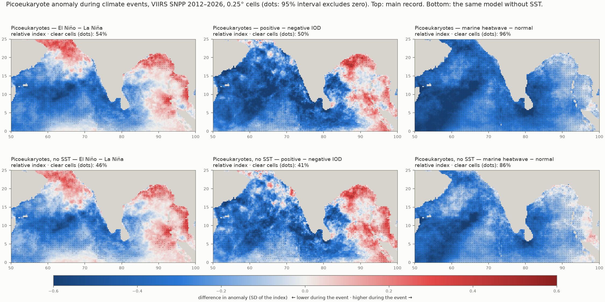
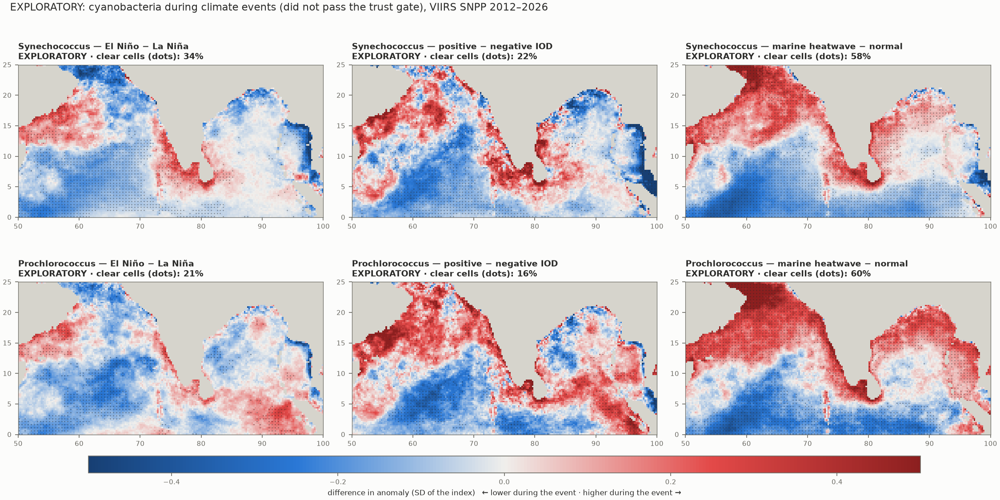

# Climate maps (RQ5, per 0.25° cell)

Generated 2026-11-21 by `picopast climate-maps`. Where in the North Indian Ocean the back-extended record moves with ENSO, the IOD and marine heatwaves. Same idea as the regional analysis (`climate.md`), cell by cell on the OISST grid. Associations, not causes; only picoeukaryotes passed the trust gate.

- Cell value: mean of the reliable 1/24° pixels (all model inputs inside the training range) in each 0.25° cell, as a relative index in SD units; at least 9 of 36 pixels needed. Anomaly: minus the cell's mean for the same 8-day slot of the year.
- ENSO: ONI 2 months earlier ≥ +0.5 vs ≤ −0.5. IOD: DMI 2 months earlier ≥ +0.4 vs ≤ −0.4 (the strongest lag regionally, for both). ENSO and IOD events overlap (2015, 2019, 2023), so the two maps are not independent.
- Heatwave: periods with at least half of the cell's days in a marine heatwave (Hobday, OISST, 1991–2020 baseline) vs periods of the same calendar months under 10%, in that same cell.
- 95% interval from resampling whole years (1000 draws). "Clear" = interval excludes zero. Neighbouring cells are correlated, so the share of clear cells is descriptive; about 5% would be expected by chance.

## How much of the ocean moves, and which way

| group | tier | event | cells with a value | mean difference (SD) | lower / higher (share of cells) | clear lower / clear higher |
| --- | --- | --- | --- | --- | --- | --- |
| picoeukaryotes | relative index | El Niño − La Niña | 13,963 | -0.13 | 72% / 28% | 48% / 6% |
| picoeukaryotes | relative index | positive − negative IOD | 13,890 | -0.25 | 81% / 19% | 47% / 3% |
| picoeukaryotes | relative index | marine heatwave − normal | 13,976 | -0.34 | 100% / 0% | 96% / 0% |
| Synechococcus | EXPLORATORY | El Niño − La Niña | 13,963 | -0.04 | 69% / 31% | 28% / 7% |
| Synechococcus | EXPLORATORY | positive − negative IOD | 13,890 | -0.03 | 61% / 39% | 19% / 3% |
| Synechococcus | EXPLORATORY | marine heatwave − normal | 13,976 | +0.00 | 53% / 47% | 35% / 23% |
| Prochlorococcus | EXPLORATORY | El Niño − La Niña | 13,963 | -0.04 | 63% / 37% | 15% / 6% |
| Prochlorococcus | EXPLORATORY | positive − negative IOD | 13,890 | +0.03 | 46% / 54% | 9% / 7% |
| Prochlorococcus | EXPLORATORY | marine heatwave − normal | 13,976 | +0.04 | 45% / 55% | 24% / 36% |

Years in each class (any period): El Niño 2014, 2015, 2016, 2018, 2019, 2020, 2023, 2024, 2026; La Niña 2012, 2016, 2018, 2020, 2021, 2022, 2023, 2025, 2026; positive IOD 2012, 2015, 2017, 2018, 2019, 2020, 2023, 2024, 2026; negative IOD 2013, 2016, 2022, 2025.

## Picoeukaryotes by area

Mean difference over the cells of each area (SD of the index), with the share of its cells that are clear in the same direction as the mean. Arabian Sea / Bay of Bengal sides split at 78°E.

| area | El Niño − La Niña | positive − negative IOD | heatwave − normal |
| --- | --- | --- | --- |
| Bay of Bengal | +0.01 (15% clear) | -0.03 (10% clear) | -0.25 (93% clear) |
| Arabian Sea C/E | -0.19 (51% clear) | -0.40 (58% clear) | -0.38 (99% clear) |
| Arabian Sea side, north of 15°N | -0.00 (19% clear) | -0.30 (34% clear) | -0.36 (99% clear) |
| Bay of Bengal side, north of 15°N | +0.11 (37% clear) | +0.11 (25% clear) | -0.15 (78% clear) |
| Arabian Sea side, 5–15°N | -0.32 (93% clear) | -0.44 (83% clear) | -0.43 (100% clear) |
| Bay of Bengal side, 5–15°N | -0.02 (15% clear) | -0.08 (14% clear) | -0.27 (93% clear) |
| Arabian Sea side, south of 5°N | -0.17 (70% clear) | -0.28 (79% clear) | -0.40 (100% clear) |
| Bay of Bengal side, south of 5°N | -0.07 (31% clear) | -0.17 (10% clear) | -0.26 (93% clear) |

## Sensor check: NOAA-20 vs SNPP, 2018–2026

The same composites from the NOAA-20 record and from SNPP restricted to the same years. Pattern r = correlation between the two maps over cells where both have a value: high means the two satellites put the change in the same places.

| group | tier | event | pattern r | mean difference, SNPP | mean difference, NOAA-20 |
| --- | --- | --- | --- | --- | --- |
| picoeukaryotes | relative index | El Niño − La Niña | 0.99 | -0.11 | -0.13 |
| picoeukaryotes | relative index | positive − negative IOD | 0.96 | -0.20 | -0.21 |
| picoeukaryotes | relative index | marine heatwave − normal | 0.98 | -0.33 | -0.34 |
| Synechococcus | EXPLORATORY | El Niño − La Niña | 0.92 | -0.05 | -0.06 |
| Synechococcus | EXPLORATORY | positive − negative IOD | 0.86 | -0.07 | -0.01 |
| Synechococcus | EXPLORATORY | marine heatwave − normal | 0.95 | -0.02 | -0.05 |
| Prochlorococcus | EXPLORATORY | El Niño − La Niña | 0.92 | -0.02 | -0.05 |
| Prochlorococcus | EXPLORATORY | positive − negative IOD | 0.86 | -0.02 | +0.08 |
| Prochlorococcus | EXPLORATORY | marine heatwave − normal | 0.96 | +0.01 | -0.03 |

## Is the picoeukaryote signal put there by SST? (model without SST)

SST is one of the model's inputs, and heatwaves (and much of ENSO's and the IOD's footprint here) are SST signals, so the model could produce a drop simply by reacting to warm water. The second row of the figure repeats every composite with the same model trained without SST (VIIRS bands, ratios, PAR, position and season only), on the same pixels. What survives is carried by the ocean's colour.

| event | mean difference, main | mean difference, without SST | survives | clear lower, main | clear lower, without SST | pattern r |
| --- | --- | --- | --- | --- | --- | --- |
| El Niño − La Niña | -0.13 | -0.10 | 74% | 48% | 39% | 0.99 |
| positive − negative IOD | -0.25 | -0.18 | 71% | 47% | 35% | 0.98 |
| marine heatwave − normal | -0.34 | -0.25 | 74% | 96% | 86% | 0.99 |

"Survives" = mean difference without SST / with SST, over the whole map. Pattern r compares where the two put the change.

## Cyanobacteria (exploratory)

These are the MOANA-based records learned from VIIRS (Route A), shown for completeness: they did not pass the trust gate and the two satellites disagree on their long-term change (`sensor_comparison.md`). The cyanobacteria records that did pass are from Route D, with their own maps in `route_d_reconstruction.md`.

