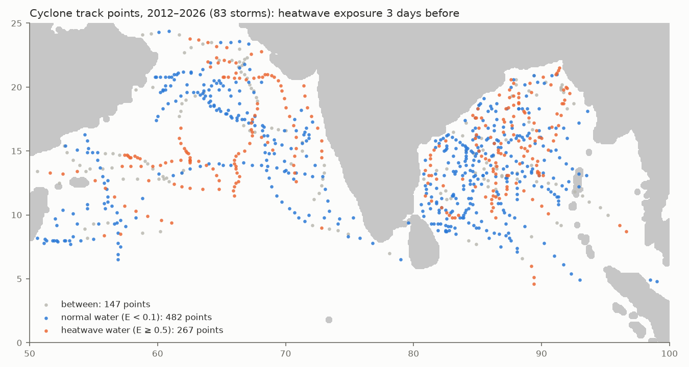
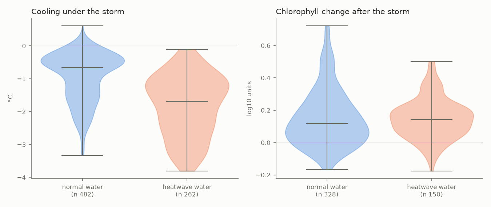

# When cyclones hit heatwaves: results

Generated 2026-11-22 by `picopast cyclone-heatwave`. Rules: `docs/cyclone_heatwave_preregistration.md`, committed before any response was computed. Intervals resample whole storms (2,000 draws).

**Data:** 896 track points from 83 storms (JTWC ≥ 34 kt, ≥ 50 km from land, 2012–2026). Heatwave points (E ≥ 0.5): 267 from 39 storms; normal points (E < 0.1): 482 from 60 storms; 147 in between. Bloom measurable at 551 points (clouds remove the rest); cooling at 884.

## RQ2: does a heatwave change the bloom? (primary)

**Verdict: no detectable difference.** Heatwave effect on the bloom, adjusted for wind, speed, latitude, basin, season, pre-storm chlorophyll, sea level and distance to land: **-0.058 [-0.125, +0.004]** log10 units (478 points, 25 storms with heatwave points, 52 with normal points).

Unadjusted: mean bloom +0.149 over heatwave water and +0.151 over normal water; difference -0.003 [-0.075, +0.070]. (+0.1 log10 = 26% more chlorophyll.)

| sensitivity check | heatwave effect [95%] | points | storms |
| --- | --- | --- | --- |
| storm-equal weights | -0.054 [-0.111, +0.002] | 478 | 64 |
| continuous E (0 to 1), all points | -0.074 [-0.148, -0.006] | 551 | 66 |
| larger post period | -0.074 [-0.147, +0.001] | 478 | 64 |
| 75 km disc | -0.076 [-0.149, -0.002] | 477 | 63 |
| 300 km disc | -0.044 [-0.105, +0.009] | 440 | 62 |
| exposure on D0 - 5 | -0.055 [-0.115, +0.011] | 483 | 65 |
| IMD winds | -0.065 [-0.136, +0.005] | 367 | 49 |
| with SMAP salinity (from May 2015) | -0.057 [-0.125, +0.008] | 349 | 49 |

By basin and season (unadjusted means):

| basin | season | heatwave points (storms) | normal points (storms) | bloom, heatwave | bloom, normal |
| --- | --- | --- | --- | --- | --- |
| Arabian Sea | post-monsoon | 53 (7) | 95 (17) | +0.207 | +0.143 |
| Arabian Sea | pre-monsoon | 2 (1) | 10 (3) | +0.079 | +0.397 |
| Bay of Bengal | other | 2 (1) | 7 (1) | +0.336 | +0.004 |
| Bay of Bengal | post-monsoon | 49 (9) | 183 (28) | +0.094 | +0.160 |
| Bay of Bengal | pre-monsoon | 44 (7) | 33 (6) | +0.134 | +0.082 |

## RQ1: cooling, heatwave ending and re-warming

- **Cooling** (°C, minimum of D0 to D0+5 minus the D0−7 to D0−3 mean): heatwave effect -0.569 [-0.855, -0.249] °C, *stronger cooling over heatwaves*; unadjusted means -1.83 (heatwave) and -0.94 (normal).
- **Heatwave survival** to D0+5: 9% of the heatwave cells under storms stayed in a heatwave, against 31% of far-away heatwave cells on the same days; difference -0.223 [-0.316, -0.115] (262 points, 38 storms).
- **Re-warming** (descriptive): back to the pre-storm anomaly within 60 days at 43% of heatwave points (median over 60 days) and 90% of normal points (median 7 days). Over heatwave water the pre-storm anomaly is the heatwave itself, so most of those heatwaves did not return.

**Post hoc check, not pre-registered** (added after the first results; it does not change the verdict above). Heatwave water cools on its own as heatwaves decay, storm or no storm. The same cooling measure, per cell, for far-away water with the same heatwave status on the same days (same basin, more than 750 km from any storm):

| | under the storm | far-away water, same days | storm's own extra cooling |
| --- | --- | --- | --- |
| heatwave points | -1.89 °C | -0.80 °C | -1.09 °C |
| normal points | -1.02 °C | -0.33 °C | -0.69 °C |

The storm's own extra cooling is still stronger over heatwave water by **-0.40 [-0.76, -0.03] °C** (744 points): about half the unadjusted gap is the heatwave decaying anyway.

## RQ3: plankton groups after PACE-era storms (descriptive)

Median change in log10 cells over each storm's points (post minus pre, 150 km). *Synechococcus* and *Prochlorococcus* from MOANA failed check C in this box: exploratory.

| storm | first day | points | picoeukaryotes | Synechococcus | Prochlorococcus | bloom (chl) | heatwave share |
| --- | --- | --- | --- | --- | --- | --- | --- |
| DANA | 2024-10-23 | 7 | +0.05 | +0.09 | -0.03 | +0.00 | 57% |
| FENGAL | 2024-11-29 | 5 | +0.24 | -0.16 | -0.08 | +0.09 | 11% |
| SHAKHTI | 2025-10-03 | 8 | +0.34 | +0.19 | +0.01 | +0.27 | 7% |
| MONTHA | 2025-10-26 | 9 | +0.49 | -0.21 | -0.01 | +0.14 | 20% |
| SENYAR | 2025-11-25 | 2 | +0.13 | -0.39 | -0.27 | -0.05 | 3% |
| DITWAH | 2025-11-29 | 2 | +0.23 | -0.29 | -0.19 | +0.04 | 0% |

## RQ4: can the response be predicted? (one storm left out at a time)

| target | model | skill vs basin × season mean | Spearman ρ |
| --- | --- | --- | --- |
| cooling | ridge | +0.45 | +0.73 |
| cooling | lgbm | +0.36 | +0.67 |
| cooling | lgbm_no_heatwave | +0.37 | +0.68 |
| bloom | ridge | +0.28 | +0.40 |
| bloom | lgbm | +0.24 | +0.35 |
| bloom | lgbm_no_heatwave | +0.24 | +0.36 |

- **cooling:** skill gained from the heatwave inputs -0.015 [-0.082, +0.047] (884 points, 82 storms); most influential inputs (SHAP): sst_pre, wind, speed_kmh, ssta_pre.

- **bloom:** skill gained from the heatwave inputs -0.001 [-0.117, +0.081] (551 points, 66 storms); most influential inputs (SHAP): chl_pre, wind, ssta_pre, lat.

## Limits

- OISST has no microwave input and under-reads cold wakes beneath cloud (same for both classes).
- 8-day chlorophyll composites smear the bloom's timing; cloud removes points (counts above).
- No mixed-layer depth after 2017; sea level and salinity stand in.
- Heatwave and normal points differ in season and basin; the model and the strata address this, not fully.
