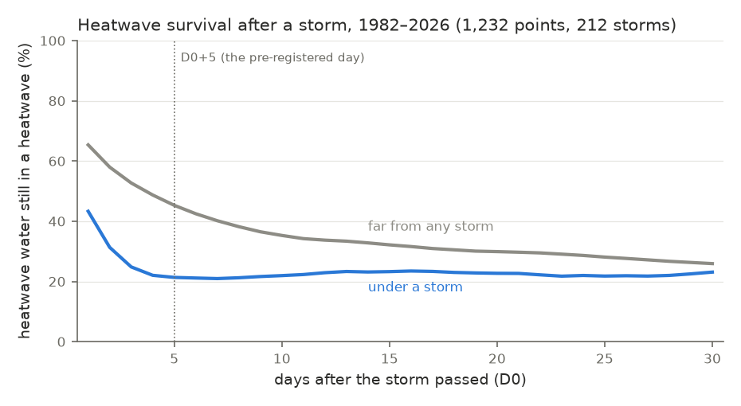
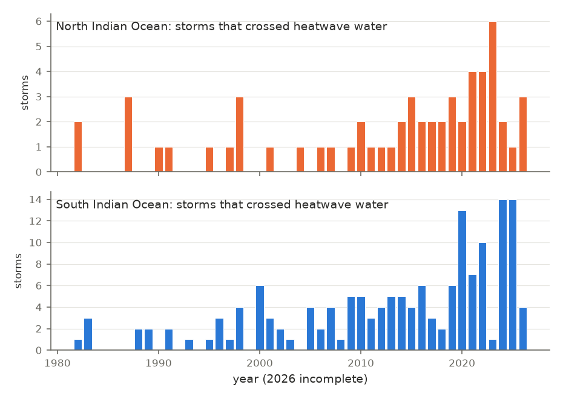

# Storms end heatwaves: the whole record, 1982–2026

Generated by `picopast heatwave-end`. Rules fixed before any of this was computed: [the pre-registration](../cyclone_heatwave_preregistration.md), section "Storms end heatwaves" (committed 28 November 2026). The bloom question (RQ2) is closed and is not part of this report.

## Checks, run before any result was read

- **North** (record 1982-01-01 to 2026-11-14). Heatwave flags against the storm-table caches: `oisst_daily_mhw.nc`: 0 of 109,860,000 cell-days differ; `oisst_daily_mhw_20011101_20120331.nc`: 0 of 76,080,000 cell-days differ. Survival against the stored tables, 1,344 points: storm share 0 mismatches, control share 0 mismatches.
- **South** (record 1982-01-01 to 2026-11-25). Heatwave flags against the storm-table caches: `oisst_daily_mhw.nc`: 0 of 277,401,600 cell-days differ; `oisst_daily_mhw_20011101_20120331.nc`: 0 of 191,721,600 cell-days differ. Survival against the stored tables, 6,484 points: storm share 0 mismatches, control share 0 mismatches.

## The answer

- **W1 (primary): storms make heatwaves end more often.**
  - Over 1982–2026, a heatwave cell under a storm is **3.5 times** as likely to end that day as one elsewhere in the same basin, month and latitude band (rate ratio 3.48 [3.09, 3.84]).
  - Stronger storms do more: 4.6 [4.1, 5.2] at 64 kt and above, 2.8 [2.5, 3.2] below.
  - But storms touch only 0.17% of heatwave cell-days, so they account for only **0.4%** of all heatwave endings [0.3%, 0.5%]: a strong but rare way for a heatwave to end.
  - Of the endings that happen under a storm, 71% would not have happened at the usual rate.
- **S1, the earlier era (1982–2001): replicated.** 15% of heatwave water survived to D0 + 5 under storms against 34% far away (-19 points [-28, -8]; 159 points, 42 storms; Holm p 0.004). With the control limited to the same 5° latitude band (D6) the earlier era gives -11 points [-24, +8] (smaller, and its interval includes zero); the whole record gives -29 points [-34, -23].
- **S2, return time: heatwaves ended by storms come back sooner.** Once a storm ends a heatwave, the next one arrives after 77 days on average, against 87 days for heatwaves that ended on their own (-9.7 days [-18.4, -1.2]; Holm p 0.025). **Not robust:** with the control limited to the same 5° latitude band (D6) the difference is -1.5 days [-11.7, +8.9], so storm-ended heatwaves return about as fast as others at the same latitude. Either way, storms do not keep heatwaves away for months.
- **S3, the next month: storms hold back heatwaves for the next month.** Heatwave days over D0 + 6 to D0 + 35: 5.3% under storms against 7.6% expected (-2.3 points [-2.9, -1.6], -30% of the expected; Holm p <0.001). The hold-back fades after the first month (D5: -0.4 points [-1.1, +0.3] in months 2–3).
- **S4, storm power: stronger, slower storms end more of the heatwave.** Survival difference per standard deviation of mixing power: -9.2 points [-12.9, -5.1] (Holm p <0.001).

## W1: the daily ending rate

Hot cell-days are ocean cells in a heatwave on a day; an ending is a hot cell-day followed by a day out of the heatwave. A cell-day is exposed when a JTWC fix of 34 kt or more lies within 150 km on that day, the day before or the day after. Rates are compared within basin × month × 5° latitude strata (Mantel–Haenszel); intervals resample calendar years (95%).

| Region | Hot cell-days | Endings | Share of hot cell-days under a storm | Ending rate, exposed | Ending rate, not | Rate ratio | Share of all endings due to storms | Verdict |
| --- | ---: | ---: | ---: | ---: | ---: | --- | --- | --- |
| Both | 73,389,733 | 5,342,498 | 0.17% | 25.7% | 7.2% | 3.48 [3.09, 3.84] | 0.4% [0.3, 0.5] | storms make heatwaves end more often |
| North | 18,338,364 | 1,416,457 | 0.16% | 31.1% | 7.7% | 4.04 [3.30, 4.78] | 0.5% [0.4, 0.6] | storms make heatwaves end more often |
| South | 55,051,369 | 3,926,041 | 0.17% | 24.1% | 7.1% | 3.29 [2.90, 3.73] | 0.4% [0.3, 0.5] | storms make heatwaves end more often |

By wind class (each against unexposed cell-days):

| Region | 34–63 kt | 64 kt and above |
| --- | --- | --- |
| Both | 2.83 [2.49, 3.16] | 4.64 [4.11, 5.15] |
| North | 3.68 [2.93, 4.41] | 4.59 [3.67, 5.74] |
| South | 2.58 [2.26, 2.96] | 4.66 [4.10, 5.33] |

Sensitivity checks (rate ratio; share of all endings due to storms):

| Variant | Both | North | South |
| --- | --- | --- | --- |
| 75 km | 3.75 [3.27, 4.18]; 0.2% [0.1, 0.2] | 4.34 [3.48, 5.18]; 0.2% [0.2, 0.3] | 3.53 [3.04, 4.06]; 0.2% [0.1, 0.2] |
| 300 km | 2.95 [2.65, 3.24]; 0.9% [0.7, 1.0] | 3.49 [2.85, 4.13]; 0.9% [0.7, 1.2] | 2.79 [2.51, 3.14]; 0.9% [0.7, 1.1] |
| window t to t+1 | 3.63 [3.17, 4.03]; 0.4% [0.3, 0.4] | 3.93 [3.15, 4.72]; 0.4% [0.3, 0.5] | 3.52 [3.07, 3.99]; 0.4% [0.3, 0.5] |
| window t-3 to t+1 | 3.01 [2.68, 3.33]; 0.5% [0.4, 0.5] | 3.94 [3.19, 4.64]; 0.5% [0.4, 0.7] | 2.75 [2.42, 3.14]; 0.4% [0.3, 0.6] |
| IMD wind | — | 4.44 [3.66, 5.28]; 0.4% [0.3, 0.5] | — |
| era 1982-2001 | 2.39 [2.02, 2.65]; 0.2% [0.1, 0.3] | 2.48 [1.92, 2.95]; 0.3% [0.2, 0.5] | 2.34 [1.91, 2.74]; 0.2% [0.1, 0.3] |
| era 2002-2026 | 3.81 [3.38, 4.23]; 0.5% [0.4, 0.6] | 4.51 [3.68, 5.48]; 0.5% [0.4, 0.6] | 3.61 [3.16, 4.15]; 0.5% [0.4, 0.6] |

## The storm-point tests (S1–S4)

14,897 track points from 915 storms, 1982–2026 (JTWC ≥ 34 kt, ≥ 50 km from land); 1,240 heatwave points from 212 storms (166 in 1982–2001, 1074 in 2002–2026). Intervals resample whole storms (5,000 draws); Holm across the four.

| Test | Estimate [95%] | Points (storms) | p | Holm p | Verdict |
| --- | --- | --- | --- | --- | --- |
| S1 survival to D0+5, storm − far, 1982–2001 | -18.9 pts [-27.8, -7.7] | 159 (42) | 0.002 | 0.004 | replicated |
| S2 return time, storm − far | -9.7 d [-18.4, -1.2] | 1162 (204) | 0.025 | 0.025 | heatwaves ended by storms come back sooner |
| S3 heatwave days in month 1, storm − expected | -2.3 pts [-2.9, -1.6] | 14817 (912) | <0.001 | <0.001 | storms hold back heatwaves for the next month |
| S4 survival per SD of mixing power | -9.2 pts [-12.9, -5.1] | 1231 (212) | <0.001 | <0.001 | stronger, slower storms end more of the heatwave |

For reference, the same survival measure over 2002–2026 is -24.7 pts [-30.1, -19.3] (1073 points), and over the whole record -23.9 pts [-28.9, -18.9] (21% under storms against 45% far away).

## Also reported (descriptive)

**D1, survival curve.** Storm minus far-away share still in a heatwave: D0+1: -22 pts [-28, -17]; D0+5: -24 pts [-29, -19]; D0+10: -13 pts [-18, -9]; D0+20: -7 pts [-12, -3]; D0+30: -3 pts [-7, +1].

**D2, encounters (north).** Storms over heatwave water per decade: 1980s: 5, 1990s: 7, 2000s: 5, 2010s: 19, 2020s: 22. Theil–Sen trend +0.5 such storms a year, per decade [+0.0, +0.8]; share of points over heatwave water +5.5 points per decade. Storm discs held heatwave water on 16.5% of their cells against 10.5% basin-wide on the same days (+5.9 pts [+3.1, +9.0]). A rise is expected with a fixed baseline in a warming ocean.

**D2, encounters (south).** Storms over heatwave water per decade: 1980s: 8, 1990s: 12, 2000s: 28, 2010s: 43, 2020s: 63. Theil–Sen trend +1.6 such storms a year, per decade [+1.1, +2.2]; share of points over heatwave water +3.5 points per decade. Storm discs held heatwave water on 8.4% of their cells against 7.1% basin-wide on the same days (+1.3 pts [+0.2, +2.3]). A rise is expected with a fixed baseline in a warming ocean.

**D3, what changes the survival effect** (storm − far share at D0 + 5, 1982–2026):

| Grouping | Level | Effect [95%] | Points (storms) |
| --- | --- | --- | --- |
| basin | Arabian Sea | -27 pts [-36, -15] | 188 (21) |
| basin | Bay of Bengal | -21 pts [-35, -7] | 168 (37) |
| basin | South Indian Ocean | -24 pts [-30, -18] | 876 (154) |
| season | SIO early | -18 pts [-26, -8] | 297 (56) |
| season | SIO late | -29 pts [-37, -22] | 501 (88) |
| season | SIO other | -12 pts [-40, +11] | 78 (13) |
| season | other | +13 pts [+1, +29] | 14 (5) |
| season | post-monsoon | -21 pts [-36, -3] | 141 (29) |
| season | pre-monsoon | -29 pts [-38, -19] | 201 (24) |
| era | 1982-2001 | -19 pts [-28, -8] | 159 (42) |
| era | 2002-2026 | -25 pts [-30, -19] | 1073 (170) |
| wind class | 34-63 kt | -18 pts [-24, -13] | 760 (179) |
| wind class | 64 kt and above | -33 pts [-39, -27] | 472 (105) |
| pre-storm SST anomaly | highest third | -23 pts [-30, -15] | 413 (86) |
| pre-storm SST anomaly | lowest third | -25 pts [-33, -17] | 406 (140) |
| pre-storm SST anomaly | middle third | -24 pts [-29, -18] | 413 (132) |

SST anomaly terciles cut at +1.16 and +1.46 °C.

**D4, sea temperature recovery** (Kaplan–Meier median days until the disc's anomaly is back within 0.2 °C of its pre-storm value; for heatwave points that value is the heatwave's own warmth): pooled: heatwave 45 d (1240 pts), normal 7 d (12181 pts); north: heatwave over 60 d (most never re-warmed within the 60 days) (364 pts), normal 7 d (1681 pts); south: heatwave 33 d (876 pts), normal 8 d (10500 pts).

**D5, longer suppression** (heatwave days, storm − expected): months 2-3: -0.4 pts [-1.1, +0.3] (-5%); months 4-8: +0.5 pts [-0.0, +1.1] (+7%); heatwave points, month 1: -4.8 pts [-7.8, -1.6]; normal points, month 1: -2.2 pts [-2.8, -1.6].

**D6, control limited to the point's 5° latitude band:** S1: -10.7 pts [-23.7, +7.8]; S2: -1.5 d [-11.7, +8.9]; S3: -3.6 pts [-4.4, -2.7]; survival 1982-2026: -28.6 pts [-34.1, -22.8].

## Limits

- Association, not proof: a storm's clouds, rain and wider wind field count as part of "the storm". The monsoon onset also ends heatwaves; the month strata address this but cannot remove it.
- Track winds before about 2000 are less certain.
- The fixed 1991–2020 baseline leaves fewer heatwaves in the 1980s, so S1 has fewer points.
- OISST under-reads cold wakes under cloud, which hides some storm endings; this works against an effect.
