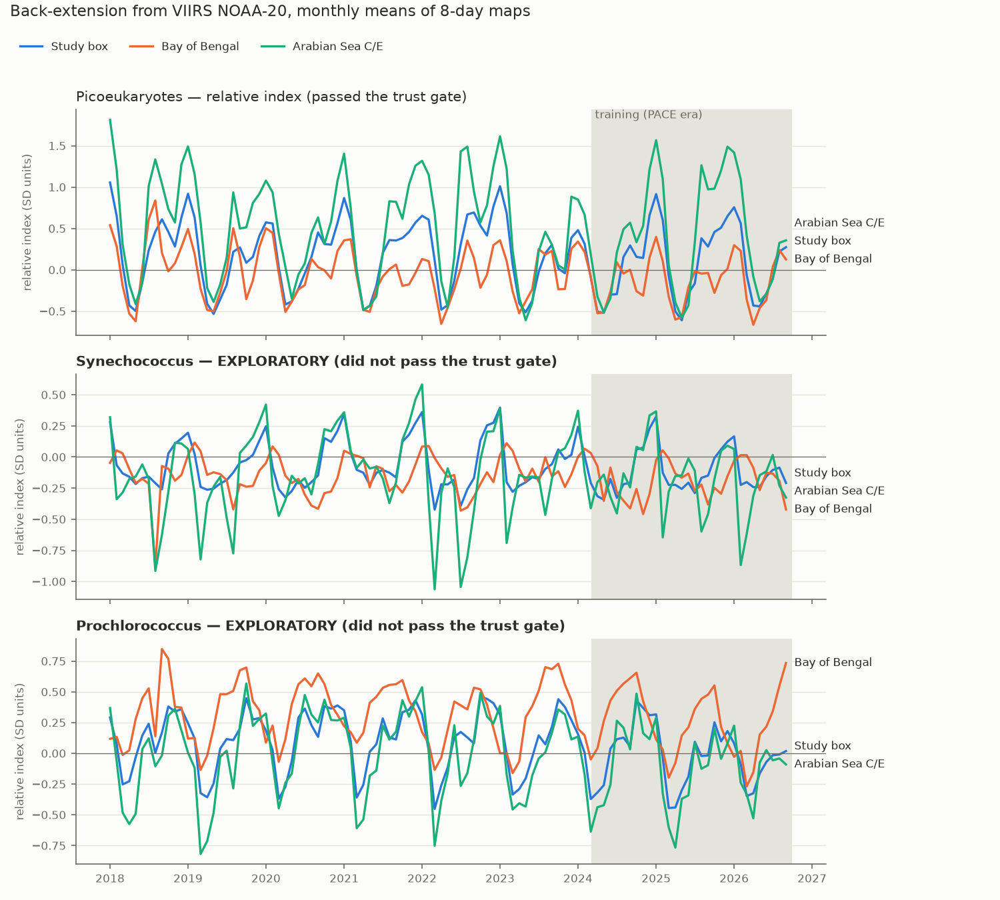

# Back-extension to 2012: first attempt

Generated 2026-11-17 by `picopast reconstruct`. Models learn MOANA (operational mapping) from VIIRS NOAA-20 8-day inputs in the PACE era and are applied to every VIIRS 8-day period on disk. They reproduce MOANA, so they can be no more right than MOANA is.

## What each group's record is

| group | tier | route used | beats climatology on held-out blocks |
| --- | --- | --- | --- |
| Prochlorococcus | exploratory: did not pass the trust gate (check A not supported; check C inconclusive) | A | yes |
| Synechococcus | exploratory: did not pass the trust gate (check C inconclusive) | A | yes |
| picoeukaryotes | relative index: passed the trust gate (check C pattern consistent) | A | yes |

Only a group that passed the trust gate is used for headline results. The exploratory records are an attempt, shown with their bottlenecks below; they are not validated estimates.

## Training data

- PACE-era 8-day periods with both MOANA and VIIRS: 118 (05 Mar 2024 to 22 Sep 2026); up to 10,000 offshore pixels sampled per period.
- Pixels per group: Prochlorococcus 1,180,000, Synechococcus 1,180,000, picoeukaryotes 1,180,000.
- Units: Prochlorococcus 1e5 cells/mL (linear); the others log10 cells/mL.
- Route A inputs: rrs410, rrs443, rrs486, rrs551, rrs671, r443_551, r486_551, r410_443, r671_551, mbr, par, sst, lat, lon, doy_sin, doy_cos. Route C inputs: sst, par.

## Validation (out of sample)

Skill = 1 − RMSE_model / RMSE_climatology (> 0 beats the seasonal climatology). Spatial: 2° blocks in 5 folds, predictions pooled. Temporal: the last 6 months of the PACE era held out. Coverage: share of held-out values inside Route A's 5–95% interval (target 85–95%).

| group | split | climatology RMSE | ridge skill | Route C skill | Route A skill | Route A ρ | Route A 90% coverage |
| --- | --- | --- | --- | --- | --- | --- | --- |
| Prochlorococcus | spatial | 0.769 | 0.02 | -0.09 | 0.18 | 0.73 | 89% |
| Prochlorococcus | temporal | 0.780 | 0.09 | -0.03 | 0.20 | 0.70 | 87% |
| Synechococcus | spatial | 0.465 | 0.03 | -0.10 | 0.20 | 0.66 | 89% |
| Synechococcus | temporal | 0.442 | 0.07 | 0.01 | 0.17 | 0.50 | 88% |
| picoeukaryotes | spatial | 0.219 | 0.28 | -0.08 | 0.40 | 0.91 | 89% |
| picoeukaryotes | temporal | 0.238 | 0.36 | 0.04 | 0.41 | 0.84 | 89% |

Inputs that matter most (share of Route A gain, or Route C if used):

- Prochlorococcus: r443_551 17%, r410_443 17%, mbr 12%, lon 9%, par 8%
- Synechococcus: r443_551 22%, r410_443 14%, lon 14%, sst 13%, doy_cos 7%
- picoeukaryotes: r486_551 61%, mbr 22%, r443_551 7%, sst 5%, lon 1%

## The reconstruction

- 402 VIIRS 8-day periods on disk, 2018–2026; maps in `data/products/reconstruction/noaa20/8D/` (median, 5% and 95% per group, plus an out-of-range count).
- Share of study-box pixels with a value, by season: fall_intermonsoon 54%, ne_monsoon 60%, spring_intermonsoon 53%, sw_monsoon 32%.

Each line is a regional monthly mean of the 8-day medians, as a relative index ((value − PACE-era mean) / PACE-era SD). The shaded span is the training period. The table view is `data/products/reconstruction/noaa20_8D_regional_means.csv`. Cloud makes June–September means rest on few pixels.

Share of reconstructed pixels with at least one input outside the 0.5–99.5% range seen in training (all groups use the same inputs, so one column):

| year | share |
| --- | --- |
| 2018 | 8.6% |
| 2019 | 9.2% |
| 2020 | 10.3% |
| 2021 | 9.1% |
| 2022 | 9.4% |
| 2023 | 8.9% |
| 2024 | 8.9% |
| 2025 | 9.6% |
| 2026 | 9.5% |

About 9% is the floor even inside the training years: with 12 inputs each allowed a 1% tail, some in-range pixels are always flagged. Years well above that floor are where the inputs drift from what the models saw.

## Bottlenecks

All groups:

- **The labels are MOANA estimates, not cell counts.** The models learn MOANA, errors included. No PACE-era cell counts exist in the box (trust gate, `docs/reports/trust_gate_fallback.md`).
- **Short training record.** 118 periods over about 2.6 years. Extending to 2012 assumes the VIIRS-to-MOANA relation holds in other years; the out-of-range table tracks input shift, not a change in the relation.
- **Monsoon cloud.** The per-period sample gives June–September 38% of training pixels, but only from the cloud-free parts of each scene; in the reconstruction 32% of study-box pixels have a value in the SW monsoon against 56% in other seasons. SW monsoon results are reported separately (PRD section 2.1).
- **Missing inputs.** No mixed-layer depth yet (needs a Copernicus Marine account). Route B and the virtual-VIIRS step wait for the VIIRS response tables.
- **Sensor drift.** Study-box index, 2023–2025 mean minus 2018–2020 mean (SD units): Prochlorococcus -0.08, Synechococcus -0.01, picoeukaryotes -0.07. Whether such a shift is in the ocean or in one sensor is judged against the other VIIRS record in `docs/reports/sensor_comparison.md` (RQ4); nothing is called a trend before the RQ5 trend tests.

Prochlorococcus (exploratory):

- Check A *not supported* (12 matched station-days, one cruise); check C *inconclusive*.
- MOANA's Prochlorococcus is a linear fit made in the Atlantic. Of the PACE-era pixels where MOANA ran, 7.8% were left out of training: 5.3% for a negative Prochlorococcus, the rest above NASA's valid maximum for some group or otherwise flagged. Positive values sit well above NASA's Atlantic output (open item 15).
- MOANA computes Prochlorococcus with an SST term, yet SST carries only 6% of the model's gain; the VIIRS band ratios carry most of it.

Synechococcus (exploratory):

- Check C *inconclusive*; check B found no relation with flow-through phycoerythrin.
- How much Synechococcus information survives in the broad VIIRS bands (RQ2) is untested until virtual VIIRS is built.

Picoeukaryotes (relative index):

- Passed check C against 1991–2005 counts, a pattern check only: the record is a relative index, never cells/mL. MOANA picoeukaryotes follow chlorophyll; a chlorophyll-only comparison is still due.

