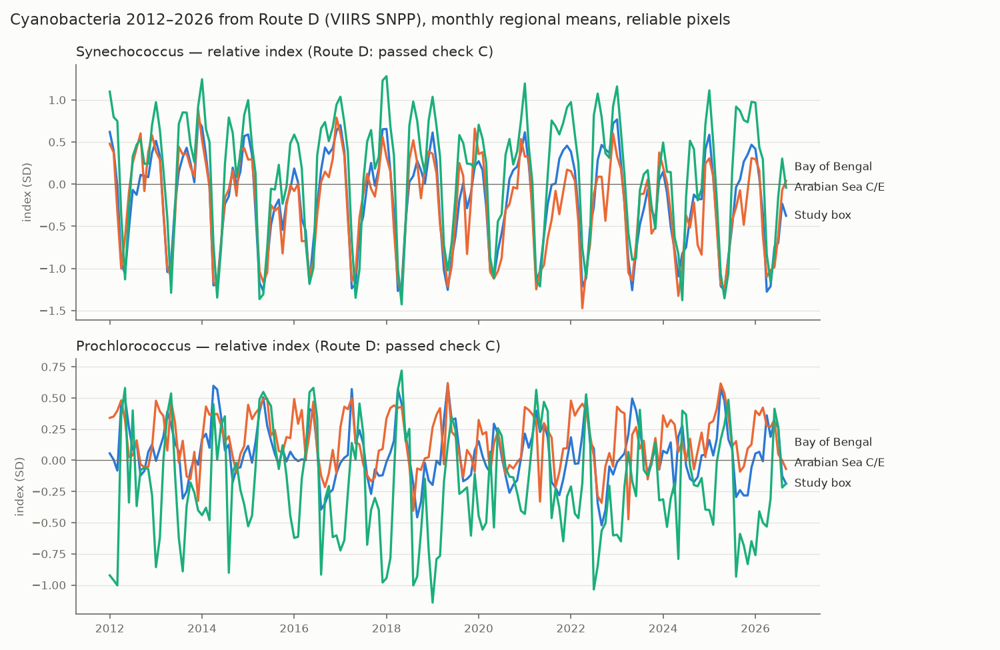
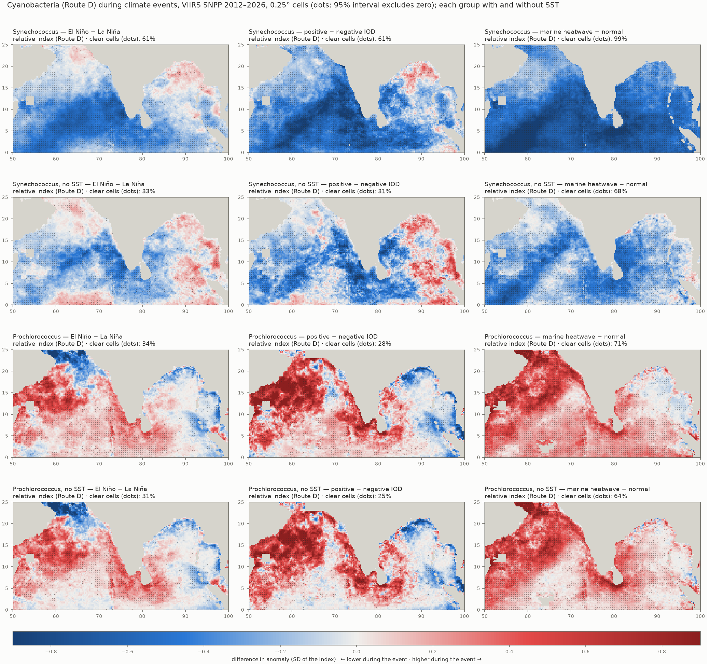

# Route D back-extension: Synechococcus and Prochlorococcus, 2012–2026

Generated 2026-11-21 by `picopast route-d-reconstruct`. The pre-registered decision (`docs/route_d_preregistration.md`): both groups passed check C with D2 (`route_d.md`), so both are reconstructed from D2 as a **relative index**. Per 8-day period: OISST, VIIRS chlorophyll and PAR, WOA23 nitrate for the month, season. Reliable pixels: every input inside the 1–99% importance-weighted range of the training samples. Index = SD units of the whole record.

| group | check C ρ, D2 | check C ρ, MOANA | training stations (effective n) | 8-day periods | reliable share of valid pixels |
| --- | --- | --- | --- | --- | --- |
| Synechococcus | 0.50 | 0.18 | 4,965 (93) | 674 | 74% |
| Prochlorococcus | 0.45 | 0.09 | 1,840 (41) | 674 | 57% |

## Against the earlier exploratory records (MOANA learned from VIIRS, Route A)

Correlation of monthly anomalies (seasonal cycle removed) between the Route D record and the earlier exploratory one, same sensor, same regions. Low values mean the two disagree on *when* the groups were high or low, not only on the level.

| group | Study box | Bay of Bengal | Arabian Sea C/E |
| --- | --- | --- | --- |
| Synechococcus | -0.01 | -0.39 | -0.48 |
| Prochlorococcus | -0.12 | -0.00 | 0.15 |

## SNPP vs NOAA-20 (same model, the other satellite's chlorophyll and PAR)

Monthly study-box index from each satellite over the overlap. Gap = mean SNPP − NOAA-20; drift = Theil–Sen slope of that difference per decade (95% interval). For comparison, the MOANA-based exploratory records drifted +0.13 (*Synechococcus*) and +0.25 (*Prochlorococcus*) SD per decade. Both copies share OISST and the nitrate climatology, so part of the agreement is built in; the models without SST see only what differs between the satellites (chlorophyll and PAR) and are the fairer test.

| group | model | months | r | gap (SD) | drift per decade [95%] |
| --- | --- | --- | --- | --- | --- |
| Synechococcus | main | 105 | 1.00 | -0.05 | -0.03 [-0.05, +0.00] |
| Synechococcus | without SST | 105 | 0.99 | +0.00 | -0.01 [-0.05, +0.01] |
| Prochlorococcus | main | 105 | 0.97 | -0.00 | +0.05 [+0.01, +0.09] |
| Prochlorococcus | without SST | 105 | 0.97 | -0.00 | +0.05 [+0.01, +0.09] |

## Climate associations (RQ5 for the cyanobacteria)

Same methods as `climate.md`. SST is a Route D input and heatwaves and ENSO are SST signals, so every result is shown next to the same model trained without SST.

### Trends (core seasons, annual means)

| region | group | years | Sen's slope per decade | p (FDR) | without SST: slope, p (FDR) |
| --- | --- | --- | --- | --- | --- |
| Arabian Sea C/E | Synechococcus | 2012–2025 | -0.12 | 0.125 | +0.04, 0.572 |
| Arabian Sea C/E | Prochlorococcus | 2012–2025 | -0.02 | 0.827 | -0.05, 0.572 |
| Bay of Bengal | Synechococcus | 2012–2025 | -0.24 | 0.006 | -0.10, 0.479 |
| Bay of Bengal | Prochlorococcus | 2012–2025 | -0.02 | 0.827 | +0.00, 0.913 |
| Study box | Synechococcus | 2012–2025 | -0.09 | 0.125 | +0.01, 0.891 |
| Study box | Prochlorococcus | 2012–2025 | -0.06 | 0.487 | -0.06, 0.572 |

### Strongest lagged correlation with ONI and DMI

| region | group | index | lag (months) | r | p (FDR) | without SST: r at the same lag |
| --- | --- | --- | --- | --- | --- | --- |
| Arabian Sea C/E | Prochlorococcus | DMI | 1 | +0.16 | 0.256 | +0.20 |
| Arabian Sea C/E | Prochlorococcus | ONI | 0 | +0.18 | 0.250 | +0.21 |
| Bay of Bengal | Prochlorococcus | DMI | 4 | -0.11 | 0.366 | -0.04 |
| Bay of Bengal | Prochlorococcus | ONI | 0 | +0.09 | 0.499 | +0.15 |
| Study box | Prochlorococcus | DMI | 2 | +0.22 | 0.121 | +0.22 |
| Study box | Prochlorococcus | ONI | 0 | +0.18 | 0.217 | +0.19 |
| Arabian Sea C/E | Synechococcus | DMI | 2 | -0.53 | 0.001 | -0.28 |
| Arabian Sea C/E | Synechococcus | ONI | 0 | -0.54 | 0.001 | -0.37 |
| Bay of Bengal | Synechococcus | DMI | 2 | -0.26 | 0.160 | -0.08 |
| Bay of Bengal | Synechococcus | ONI | 6 | -0.26 | 0.206 | -0.05 |
| Study box | Synechococcus | DMI | 2 | -0.60 | 0.000 | -0.34 |
| Study box | Synechococcus | ONI | 0 | -0.56 | 0.002 | -0.41 |

### Marine heatwaves

Reliable pixels thin out during heatwaves because the warmest water leaves the training range (*Prochlorococcus* training SST ends at 29.9 °C, *Synechococcus* at 30.3 °C). A composite over reliable pixels then compares cooler water during heatwaves with all water otherwise. The last column repeats it with every valid pixel (the model holds its edge value beyond the range, so this is conservative). Read a heatwave result only where both agree in sign.

| region | group | reliable pixels, heatwave / normal | heatwave − normal [95%] | without SST | all valid pixels |
| --- | --- | --- | --- | --- | --- |
| Arabian Sea C/E | Synechococcus | 65% / 78% | -0.42 [-0.47, -0.35] | -0.10 [-0.17, -0.03] | -0.52 [-0.58, -0.43] |
| Arabian Sea C/E | Prochlorococcus | 52% / 62% | +0.06 [-0.03, +0.15] | +0.10 [+0.01, +0.21] | +0.21 [+0.13, +0.30] |
| Bay of Bengal | Synechococcus | 67% / 80% | -0.50 [-0.66, -0.38] | -0.17 [-0.34, -0.08] | -0.55 [-0.67, -0.46] |
| Bay of Bengal | Prochlorococcus | 52% / 69% | +0.02 [-0.05, +0.07] | +0.06 [-0.01, +0.12] | +0.06 [+0.03, +0.11] |
| Study box | Synechococcus | 64% / 79% | -0.35 [-0.56, -0.21] | -0.06 [-0.17, +0.01] | -0.48 [-0.57, -0.39] |
| Study box | Prochlorococcus | 48% / 60% | -0.07 [-0.15, +0.09] | -0.06 [-0.15, +0.11] | +0.15 [+0.06, +0.20] |

### Maps per 0.25° cell

Same composites as `climate_maps.md`.

| group | event | mean difference (SD) | clear lower / clear higher | without SST: mean, pattern r | all valid pixels: mean, clear lower / higher, pattern r |
| --- | --- | --- | --- | --- | --- |
| Synechococcus | El Niño − La Niña | -0.24 | 60% / 1% | -0.10, 0.70 | -0.22, 59% / 2%, 0.98 |
| Synechococcus | positive − negative IOD | -0.37 | 61% / 0% | -0.15, 0.72 | -0.37, 61% / 0%, 0.97 |
| Synechococcus | marine heatwave − normal | -0.56 | 99% / 0% | -0.25, 0.58 | -0.52, 100% / 0%, 0.96 |
| Prochlorococcus | El Niño − La Niña | +0.08 | 6% / 28% | +0.08, 0.96 | +0.09, 6% / 35%, 0.88 |
| Prochlorococcus | positive − negative IOD | +0.18 | 7% / 22% | +0.18, 0.96 | +0.19, 7% / 26%, 0.94 |
| Prochlorococcus | marine heatwave − normal | +0.26 | 3% / 68% | +0.24, 0.89 | +0.23, 2% / 75%, 0.88 |

## Limits

- D2 learned from climatological chlorophyll and PAR and 1987–2011 counts; here it reads 8-day values. The reliable flag keeps it inside the weighted training range, but 8-day extremes are rarer there.
- Its check C skill is about that of chlorophyll alone (`route_d.md`): the record says where and when each group is high or low in the way the global data relate them to chlorophyll, SST, light and nitrate, not more.
- Nitrate is a fixed climatology; year-to-year change enters through SST, chlorophyll and PAR only.
