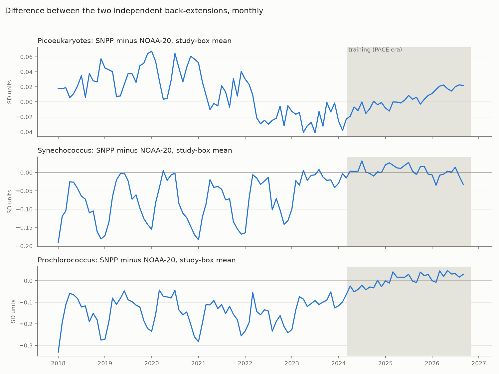

# SNPP vs NOAA-20 back-extensions (RQ4)

Generated 2026-11-17 by `picopast sensor-comparison`. The two records are built independently (each sensor's own bands and models, trained on the same PACE-era MOANA). Compared on 398 common 8-day periods, Jan 2018 to Sep 2026, pixel by pixel where both have a value.

## Agreement

PRD pass condition: at least 80% of open-ocean pixels agree within the stated uncertainty. Here: the NOAA-20 median inside SNPP's 5–95% interval. The looser test (the two intervals overlap) is shown too.

| group | tier | pixel-periods | NOAA-20 inside SNPP interval | intervals overlap | PRD (≥80%) | typical gap between the records |
| --- | --- | --- | --- | --- | --- | --- |
| Prochlorococcus | exploratory | 112,701,762 | 99% | 100% | pass | 0.10 SD |
| Synechococcus | exploratory | 112,701,762 | 100% | 100% | pass | 0.04 SD |
| picoeukaryotes | relative index | 112,701,762 | 98% | 100% | pass | 0.02 SD |

The test is easy to pass: each interval carries the model's error against MOANA, which is much larger than the gap between two models fed by similar sensors. The last column (median over periods of |SNPP − NOAA-20| in the study-box mean, in SD units of the index) is the sharper measure.

## Drift between the records

Study-box mean of SNPP minus NOAA-20 per period, in SD units of each group's index. A slope means one record drifts against the other; a change in the ocean would appear in both records and cancel here.

| group | mean difference | Theil–Sen slope per decade (95%) |
| --- | --- | --- |
| Prochlorococcus | -0.10 | +0.25 [+0.19, +0.30] |
| Synechococcus | -0.05 | +0.13 [+0.09, +0.17] |
| picoeukaryotes | +0.01 | -0.04 [-0.06, -0.02] |

## Change since 2018 in each record

Study-box index, 2023–2025 mean minus 2018–2020 mean, each record in its own SD units. A change seen by both sensors is a candidate ocean signal (still to be tested in RQ5); a change seen by one only is treated as that sensor's drift.

| group | SNPP | NOAA-20 | seen by both |
| --- | --- | --- | --- |
| Prochlorococcus | +0.01 | -0.08 | no |
| Synechococcus | +0.06 | -0.01 | no |
| picoeukaryotes | -0.11 | -0.07 | yes |

"Seen by both" means the same sign and at least 0.05 SD in each record.

The early-to-late shift in the SNPP record (`docs/reports/reconstruction.md`, Sensor drift) is read against these tables: a slope near zero and a change seen by both mean SNPP drift does not explain it.
